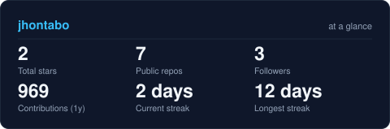
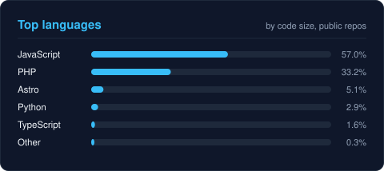
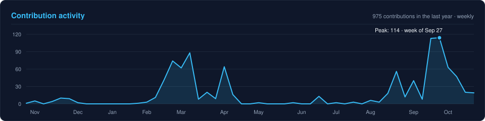

<!-- BANNER - animated 1-bit portrait morph. Regenerated by the Banner workflow
     from assets/source/ (scripts/banner/generate.py). -->
<picture>
  <source media="(prefers-color-scheme: dark)" srcset="assets/banner-dark.svg">
  <source media="(prefers-color-scheme: light)" srcset="assets/banner-light.svg">
  
</picture>

 

<!-- NAME / TAGLINE - animated typing -->

 

  
  
  
  

---

## 👨‍💻 About me

I'm **Jhon Tajumbina**, a **Systems Engineer** from Colombia and a **Media Buyer / Digital Trafficker**.

I build digital products that solve real problems — mobile apps, websites and custom systems with clean interfaces, solid performance and smooth UX.

On the marketing side, I plan, run and optimize **Meta Ads** campaigns that turn attention into measurable results for businesses and brands. Code + ads means I can ship the product *and* bring it customers.

## ⚡ Right now

- 🔭 Building mobile apps with **Flutter** and web platforms with **Laravel** and **Next.js**
- 🌱 Leveling up in **TypeScript**, **Docker** and **AWS**
- 💼 Open to freelance work: apps, websites and **Meta Ads** campaigns
- 📫 Reach me at **jhonse.tajumbina@gmail.com** or on [LinkedIn](https://www.linkedin.com/in/jhon-tajumbina-8917922a3)

---

## 🛠️ Tech stack

  

    

  
  
  
  

---

## 📡 Signals

<table>
<tr>
<td width="50%" align="center" valign="middle">

<!-- Self-rated radar - edit assets/skills.json, the Charts workflow redraws it -->
<picture>
  <source media="(prefers-color-scheme: dark)" srcset="assets/radar-dark.svg">
  <source media="(prefers-color-scheme: light)" srcset="assets/radar-light.svg">
  
</picture>

</td>
<td width="50%" align="center" valign="middle">

<!-- Live language mix from public repos - refreshed weekly by the Charts workflow -->
<picture>
  <source media="(prefers-color-scheme: dark)" srcset="assets/radar-langs-dark.svg">
  <source media="(prefers-color-scheme: light)" srcset="assets/radar-langs-light.svg">
  
</picture>

</td>
</tr>
</table>

---

## 📊 GitHub in numbers

<!-- Stats + languages cards and activity chart - scripts/stats.py, refreshed weekly by the Charts workflow -->
<table>
<tr>
<td width="50%" align="center" valign="middle">

<picture>
  <source media="(prefers-color-scheme: dark)" srcset="assets/stats-dark.svg">
  <source media="(prefers-color-scheme: light)" srcset="assets/stats-light.svg">
  
</picture>

</td>
<td width="50%" align="center" valign="middle">

<picture>
  <source media="(prefers-color-scheme: dark)" srcset="assets/languages-dark.svg">
  <source media="(prefers-color-scheme: light)" srcset="assets/languages-light.svg">
  
</picture>

</td>
</tr>
</table>

<picture>
  <source media="(prefers-color-scheme: dark)" srcset="assets/activity-dark.svg">
  <source media="(prefers-color-scheme: light)" srcset="assets/activity-light.svg">
  
</picture>

  

<!-- 3D calendar + snake - Contributions workflow, published to the output branch -->
<picture>
  <source media="(prefers-color-scheme: dark)" srcset="https://raw.githubusercontent.com/jhontabo/jhontabo/output/contrib-3d-dark.svg">
  <source media="(prefers-color-scheme: light)" srcset="https://raw.githubusercontent.com/jhontabo/jhontabo/output/contrib-3d-light.svg">
  
</picture>

  
<picture>
  <source media="(prefers-color-scheme: dark)" srcset="https://raw.githubusercontent.com/jhontabo/jhontabo/output/github-snake-dark.svg">
  <source media="(prefers-color-scheme: light)" srcset="https://raw.githubusercontent.com/jhontabo/jhontabo/output/github-snake.svg">
  
</picture>

---

Design and SVG system based on <a href="https://github.com/emmi-lili/emmi-lili">emmi-lili/emmi-lili</a> 💜

