<!-- BANNER - terminal profile.sh --live. Estatico por ahora (scripts/banner/static.py).
     Para el morph animado 1-bit como emmi-lili: pon tu foto en assets/source/jhon.png
     e instala requirements y corre: python scripts/banner/generate.py -->
<picture>
  <source media="(prefers-color-scheme: dark)" srcset="assets/banner-dark.svg">
  <source media="(prefers-color-scheme: light)" srcset="assets/banner-light.svg">
  
</picture>

 

<!-- NAME / TAGLINE - animated typing -->

 

  
  
  

---

## 👨‍💻 Sobre Mí

¡Hola! Soy **Jhon Tajumbina**, **Ingeniero de Sistemas** de Colombia y **Media Buyer / Digital Trafficker**.

Construyo productos digitales que resuelven problemas reales: aplicaciones móviles, sitios web y sistemas a la medida, siempre con interfaces limpias, rendimiento óptimo y una experiencia de usuario fluida.

Además del desarrollo de software, combino la ingeniería con el marketing digital como **Trafficker**, planificando, ejecutando y optimizando campañas publicitarias en **Meta Ads** para convertir atención en resultados medibles y rentabilidad para negocios y marcas.

---

## 🛠️ Dominio Técnico

  

 

| Área | Tecnologías & Habilidades |
| :--- | :--- |
| **Frontend** | React, Next.js, Tailwind CSS, Astro, HTML5, CSS3, JavaScript (ES6+), TypeScript |
| **Backend & APIs** | Laravel, Node.js, Express.js, PHP, MySQL / MariaDB, JWT, Firebase |
| **Móvil** | Flutter, Dart, Android |
| **Herramientas & Entorno** | Linux (Debian / Ubuntu / BSPWM), Bash, Neovim, Git, GitHub, Docker, AWS, WSL, Figma |
| **Marketing Digital & Ads** | Meta Ads (Facebook & Instagram Ads), TikTok Ads, Google Ads, Embudos de Conversión |

---

## signals

<table>
<tr>
<td width="50%" align="center" valign="middle">

<!-- Self-rated radar - edit assets/skills.json, the workflow redraws it -->
<picture>
  <source media="(prefers-color-scheme: dark)" srcset="assets/radar-dark.svg">
  <source media="(prefers-color-scheme: light)" srcset="assets/radar-light.svg">
  
</picture>

</td>
<td width="50%" align="center" valign="middle">

<!-- Hand-authored stack radar - edit assets/langmix.json -->
<picture>
  <source media="(prefers-color-scheme: dark)" srcset="assets/radar-langs-dark.svg">
  <source media="(prefers-color-scheme: light)" srcset="assets/radar-langs-light.svg">
  
</picture>

</td>
</tr>
</table>

---

## 💜 Créditos

Este README y su sistema de SVG (banner, radares, tarjetas) están basados en el excelente trabajo de
**[emmi-lili](https://github.com/emmi-lili)** → [github.com/emmi-lili/emmi-lili](https://github.com/emmi-lili/emmi-lili).

¡Gracias por la inspiración y el código abierto! 🌺

